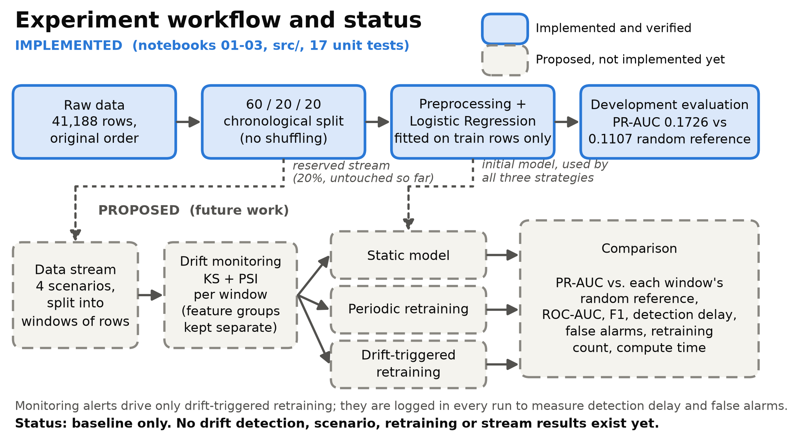
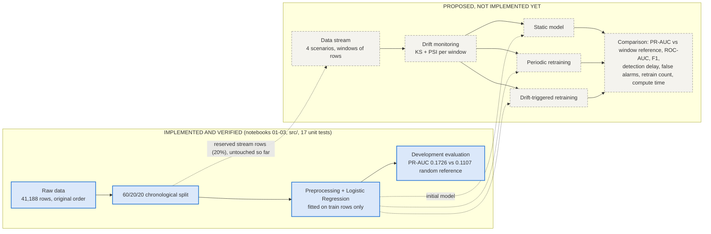

# Experiment design: retraining strategies under data drift (mid-semester draft)

> **Conceptual design.** Everything marked **PROPOSED** is not implemented and has no results. Claims about our data and model come only from the verified notebooks (`01_EDA`, `02_leakage_review`, `03_baseline_logreg`). Nothing here says that any retraining strategy works better than another; that is what the experiments are for.

## 1. Implemented vs. proposed

| | Status |
|---|---|
| Data check and EDA (notebook 01); leakage review (notebook 02) | **Implemented, verified** |
| `src/` loading, 60/20/20 chronological split, leakage-safe 10-feature preprocessing; 17 unit tests | **Implemented, verified** |
| One untuned Logistic Regression baseline, evaluated on development rows (notebook 03): PR-AUC 0.1726 vs. 0.1107 random reference, ROC-AUC 0.5819, 0 rows predicted yes at 0.5 | **Implemented, verified** (preliminary) |
| Drift detection per window (KS, PSI), windows and label delay, scenario generators, the three strategies, stream evaluation, cost tracking, seeds and statistics | **PROPOSED, not started** |

## 2. Three kinds of drift

| Type | Meaning | What we have observed | What we have not shown |
|---|---|---|---|
| **Covariate** | The distribution of the inputs changes | Early vs. late rows (illustrative 70/30 cut): all five economic indicators differ strongly (KS 0.59 to 1.00, PSI 4.48 to 11.52); `age` (KS 0.095, PSI 0.12) and `campaign` (KS 0.090, PSI 0.05) much less | That these shifts hurt a model |
| **Label / prior** | The share of "yes" changes | Positive rate 4.81% in training rows vs. 11.07% in development rows (illustrative early/late: 5.6% vs. 24.6%). It also moves the random-guess PR-AUC baseline | The mechanism behind the change |
| **Concept** | The relationship between inputs and outcome changes | **Nothing.** We have not tested for it, and input-distribution checks cannot show it. A changed positive rate alone does not establish it | Any concept drift. An optional synthetic scenario is possible only after the core results |

## 3. KS and PSI: what they measure and their limits

**KS (Kolmogorov-Smirnov), PROPOSED as a per-window test on numeric features.** It measures the largest gap between two cumulative distributions (0 to 1). The **KS statistic is an effect size** (how large the difference is); the **p-value measures only statistical detectability**. With about 41,000 rows even small differences give tiny p-values, so a small p-value alone does not mean a big or important shift. Limits: one feature at a time; p-values are approximate for features with few distinct values and many ties (four of our five economic indicators have only 10 to 26 distinct values); not directly applicable to categorical features; testing many features across many windows produces false alarms; it says nothing about model performance.
*Note on the notebook's "0.0":* the drift table shows p-values rounded to three decimals, so 0.0 means "below 0.0005", not a literal zero probability. A separate recomputation (not a notebook output) gives about 4.9e-69 for `age` and 1.7e-61 for `campaign`, and the five economic indicators underflow to 0.0 in floating-point arithmetic, which means extremely small, not impossible.

**PSI (Population Stability Index), PROPOSED as a per-window magnitude measure.** It compares the share of rows in each bin between a reference and a new window. The usual 0.1 / 0.25 cut-offs are rules of thumb, not statistical tests. Limits: it depends on how bins are built and on a small floor applied to empty bins; for the economic indicators their exact values (4.48 to 11.52) should not be over-interpreted: for three of them (`euribor3m`, `emp.var.rate`, `nr.employed`) most bins are empty in one of the two periods. In a separate sensitivity check, changing the floor moved these values a lot while all stayed above 0.25. It is also one feature at a time and does not measure performance.

**Monitoring rule of thumb:** customer/campaign features and economic indicators are monitored separately, and an alert does not imply that predictions got worse.

## 4. Four scenarios (all PROPOSED)

| # | Scenario | How the stream is built | Real or synthetic | Main purpose |
|---|---|---|---|---|
| 1 | **Real chronological replay** | The reserved last 20% (8,238 rows) in original order, cut into windows; labels revealed after a label delay | Real data | Behaviour under whatever change really exists; no known change point |
| 2 | **Stationary controlled stream** | Windows sampled from one fixed reference distribution, with no training rows leaking into evaluation | Synthetic sampling of real feature-label pairs | False alarms and needless retraining when nothing changes |
| 3 | **Sudden covariate shift** | At a chosen window, observed rows are resampled or reweighted (documented weights) so a feature group's distribution jumps | Synthetic | Detection delay with a known change point |
| 4 | **Gradual covariate shift** | The same weights move step by step over several windows | Synthetic | Detection delay and strategy behaviour under slow change |

Synthetic manipulations are labelled as such and are not historical evidence. Which rows scenarios 2 to 4 sample from, without touching model training or tuning, is still open.

## 5. Three strategies (all PROPOSED)

All use the same streams, the same predeclared seeds, the same model type and features (first baseline: Logistic Regression on the 10 conservative features). Retraining may use only rows from **earlier** windows whose labels count as available under the label delay, never the current or any future window, and preprocessing is refitted on exactly the rows used.

1. **Static:** fit once on the training rows and never retrain.
2. **Periodic:** retrain every *k* windows (*k* undecided).
3. **Drift-triggered:** retrain when the monitoring rule fires (tests, feature groups and thresholds undecided; calibrated on development data only).

## 6. How strategies will be compared (PROPOSED)

| Quantity | Plan |
|---|---|
| **Predictive performance** | PR-AUC per window, always beside that window's random-guess PR-AUC (its positive rate); also ROC-AUC, F1, precision, recall with the threshold stated. Our baseline shows why this matters: a fixed 0.5 produced zero predicted positives, so the threshold choice stays a pending decision |
| **Detection delay** | Windows between the true change point and the first alert; defined only where the change point is known (scenarios 3 and 4). In scenario 1 we would report when alerts occur relative to observed performance changes instead |
| **False alarms** | Alerts in the stationary scenario and alerts before the change point in scenarios 3 and 4; alerts not followed by a performance drop are a secondary count (definition undecided) |
| **Retraining cost** | Number of retrains and compute time on the same machine |
| **Reliability** | Several predeclared seeds; their number and the statistical test are undecided |

## 7. Workflow

*(PNG source: `figures/make_experiment_workflow.py`.)*

Monitoring alerts drive only the drift-triggered strategy; they are logged in every run to measure detection delay and false alarms.

## 8. Open decisions (from `DECISIONS.md`; none are resolved here)

Window size; label delay; primary decision threshold (fixed 0.5 or re-tuned); expanding vs. sliding retraining data; periodic interval; drift-trigger rule; whether economic indicators are model features; number of seeds and the statistical test; whether reconstructed year-month labels may be used for labelling; whether the current-contact features and the economic indicators were available before the call. **Not yet logged:** which rows scenarios 2 to 4 sample from.

## 9. Design risks (hypotheses to keep in mind)

- **The baseline is weak** (PR-AUC 0.1726 vs. 0.1107; in-sample ROC-AUC 0.553). If the model carries little signal, differences between strategies may be hard to see.
- **The economic indicators, which shift most, are not in the baseline model.** Alerts on them may fire without any effect on this model's predictions.
- **History features are rare in the training rows** (130 rows with `previous > 0`). A retrained model may change mainly because new feature values appear, so improvements need careful interpretation.
- **Only one real stream exists**, and real shifts are entangled. Synthetic scenarios give control but are not evidence about the real world.

## 10. Slide-ready summary of the research design

- **Question:** can drift-triggered retraining keep a classical model's predictions better than a static or periodically retrained one?
- **Where we are:** data checked, a leakage review done, a chronological 60/20/20 split and a leakage-safe pipeline built, one baseline measured on development rows (PR-AUC 0.1726 vs. 0.1107 random). This is preliminary.
- **What we see in the data:** inputs and the positive rate differ between early and late rows (e.g. positive rate 4.81% vs. 11.07%). This motivates the study; it does not prove that drift hurts a model.
- **Proposed experiment:** 4 scenarios (real replay, stationary, sudden shift, gradual shift) x 3 strategies (static, periodic, drift-triggered).
- **Drift monitoring:** KS (effect size, not just p-values) and PSI per window, with customer/campaign and economic features monitored separately.
- **What we will compare:** PR-AUC against each window's random reference, detection delay, false alarms, retraining count and compute time, over predeclared seeds.
- **Not done yet:** drift detection, scenarios, strategies and all stream results.
